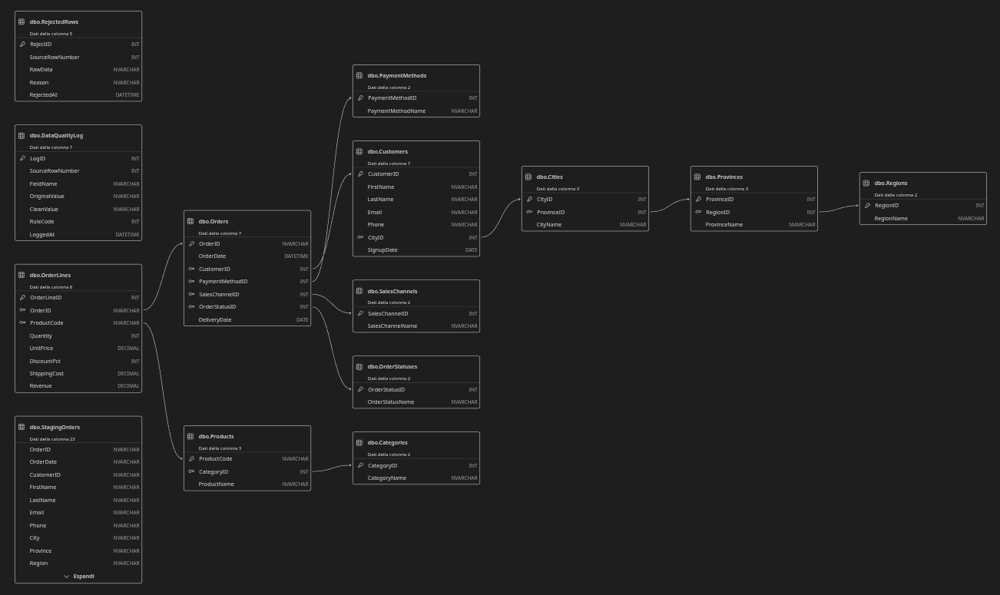

# Corso Gestione DB

Progetto per la realizzazione di un software ETL (Extract Transform Load) in C#

## Compatibilità

Il progetto supporta:

- .NET 10
- MS SQL Server 2025

## Schema delle tabelle

Gli script sql di creazione e inserimento si trovano nella cartella `dataset`
